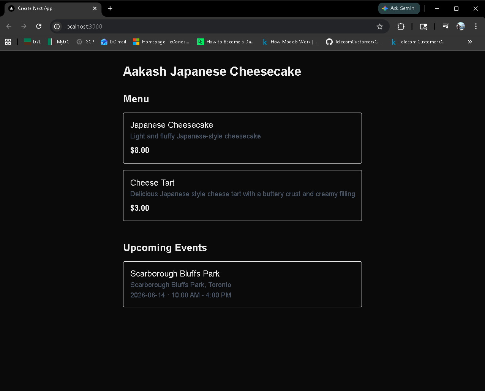
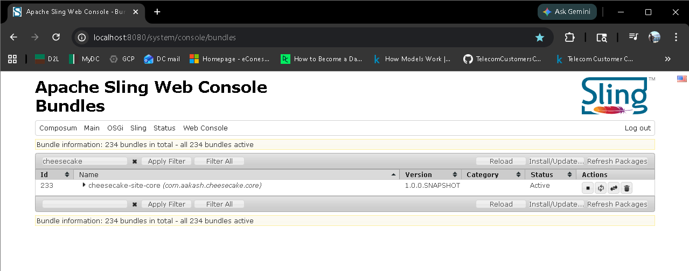
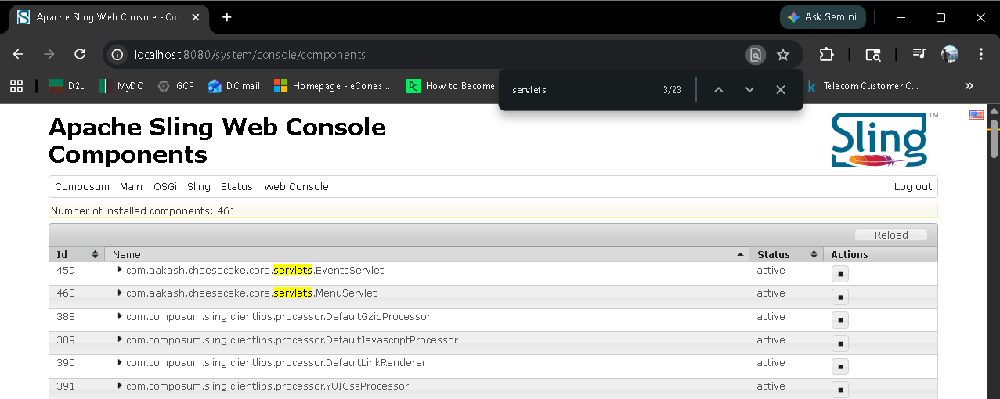
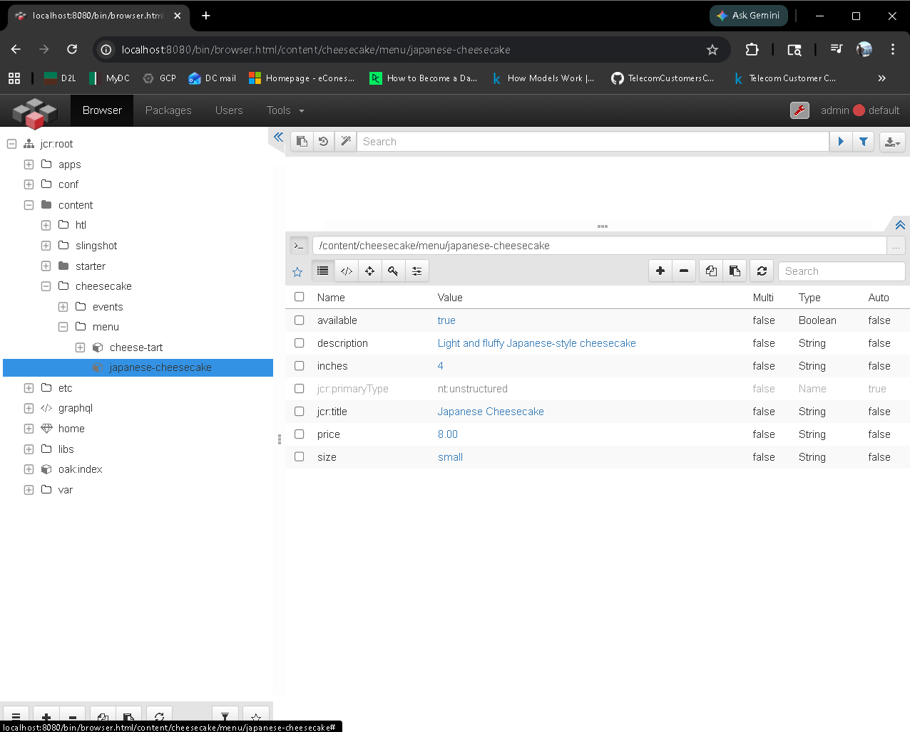
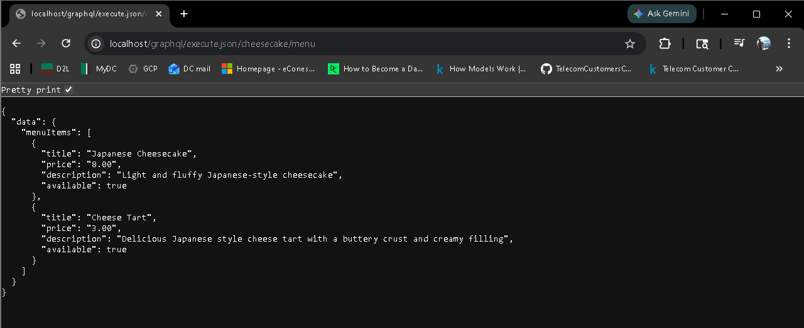
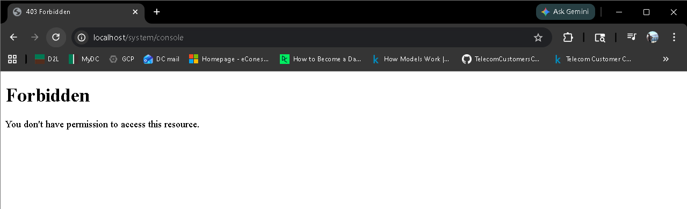

# Cheesecake Site — local AEM-style headless stack

A local Docker Compose portfolio that follows the request path of an Adobe Experience Manager (AEM) headless setup: Next.js, an Apache httpd dispatcher layer, and Apache Sling with OSGi and JCR. It is not a licensed AEM instance, and it is not a deployed production site. Nothing in this repo is published to AEMaaCS, AMS, or a public host. The menu and events are sample content so the stack has something to render.

There is no GraphQL runtime. The JSON endpoints are OSGi servlets. AEM persisted queries are a different mechanism; see [How this maps to AEM](#how-this-maps-to-aem).

## Author

**Aakash** — AEM Engineer candidate, Scarborough, Ontario

- Accenture (client Chubb), January–October 2021 — AEM 6.x
- Zoho, November 2021–December 2022 — Android
- Nearly two years in industry, AEM then Android. Not two years of AEM.
- AEM Sites Developer Professional certification in progress (AD0-E123)

## Request flow

```
Browser  →  Next.js (:3000)  →  httpd dispatcher layer (:80)  →  Apache Sling (:8080)
```

1. The browser loads the page from Next.js.
2. The Next.js server component fetches JSON from the dispatcher (`API_URL`, `http://dispatcher` on the Compose network).
3. httpd applies a deny-by-default allow-list. Permitted GETs are served from the disk cache or proxied to Sling. Everything else is 403.
4. Sling resolves the resource and calls the OSGi servlet registered for that resource type, selector, and extension.
5. The servlet reads child JCR nodes and writes JSON.

```
┌──────────────┐   HTTP :3000   ┌──────────────┐   HTTP :80    ┌────────────────────┐   HTTP :8080   ┌──────────────┐
│   Browser    │ ─────────────► │   Next.js    │ ────────────► │ httpd dispatcher   │ ────────────► │ Apache Sling │
│              │                │ server fetch │               │ allow-list + cache │               │ OSGi + JCR   │
└──────────────┘                └──────────────┘               └────────────────────┘               └──────────────┘
```

Sling is not exposed to the browser in this setup. The publish port 8080 is mapped for local admin (Felix console, package install) the way an engineer reaches an author or a local SDK. The dispatcher is what the frontend is configured to call.

## How this maps to AEM

| This repo | AEM equivalent | Honest gap |
|---|---|---|
| Browser | Browser | — |
| Next.js server component | Headless Next.js (or SPA) consuming publish APIs | No AEM SPA Editor, no Universal Editor |
| Apache httpd allow-list | Dispatcher `/filter` in `dispatcher.any`, first rule `deny *` | `mod_rewrite`, not `mod_dispatcher.so` |
| `mod_cache_disk`, 5-minute TTL | Dispatcher cache. AEMaaCS `/enableTTL` is the TTL backstop | No `.stat` files |
| `POST /dispatcher/invalidate` from a private IP | Flush replication agent. `/allowedClients` restricts who may flush. `mod_dispatcher` touches `.stat` files at `/statfileslevel` | No author instance, so nothing flushes on its own when a node changes |
| Apache Sling + Felix + JCR | AEM publish runtime (Sling, Felix, JCR, Oak) | No author, no Oak console, no replication queue |
| `nt:unstructured` nodes under `/content/cheesecake` with `sling:resourceType` | Content Fragments, or components addressed by resource type | No Content Fragment Models, no DAM |
| OSGi servlet, resource type + `model` selector + `json` extension | Sling servlet or Sling Model Exporter at `*.model.json` | Hand-built JSON, not the Model Exporter |
| AEM persisted query URL `/graphql/execute.json/<project>/<query>` | GraphQL engine runs a stored query | **Not implemented.** These servlets do not parse GraphQL |
| FileVault content package | Content package installed with Package Manager or Cloud Manager | Installed with `sling:install` against local Sling |
| `SLING_ADMIN_*` environment variables | Service users on publish. IMS on AEMaaCS. Console credentials are not committed | Local Sling still has a web console account; the password stays in `.env` |

### Persisted queries vs these servlets

AEM headless persisted queries are GraphQL documents stored in the repository and executed by the GraphQL engine:

```
GET /graphql/execute.json/<configuration>/<persisted-query-name>
```

The response is a GraphQL `data` payload (or `errors`). This project does not ship that engine. An earlier revision bound servlets directly onto `/graphql/execute.json/cheesecake/menu` and `/events` with `@SlingServletPaths`. That copied the URL and still returned hand-built JSON, which reads as GraphQL when it is not.

Path binding also skips resource resolution: the servlet does not see `sling:resourceType`, selectors, or the resource Sling resolved. Adobe's servlet guidance is to register by resource type and use a selector plus an extension. These servlets now do that, and the frontend calls the resource URLs:

```
GET /content/cheesecake/menu.model.json
GET /content/cheesecake/events.model.json
```

The `data` wrapper in the JSON is only a stable shape for the React page. Nothing parses a GraphQL document. The `model` selector matches the familiar `.model.json` URL shape; the response is not produced by `org.apache.sling.models` exporter.

## Project structure

```
cheesecake-site-headless/
├── cheesecake-site/
│   ├── pom.xml
│   ├── core/                          # OSGi bundle
│   │   └── src/main/java/.../servlets/
│   │       ├── MenuServlet.java       # resource type cheesecake/components/menu
│   │       └── EventsServlet.java     # resource type cheesecake/components/events
│   └── ui.content/                    # FileVault package
│       └── src/main/content/jcr_root/content/cheesecake/
├── dispatcher/
│   ├── Dockerfile
│   ├── httpd.conf                     # deny-by-default allow-list
│   ├── docker-entrypoint.sh
│   └── cgi-bin/invalidate             # cache flush
├── frontend/                          # Next.js
├── scripts/
│   ├── deploy-to-sling.sh             # build, install, flush
│   └── flush-dispatcher.sh
├── docker-compose.yml
├── .env.example
└── README.md
```

## Quick start

Requirements: Docker, Java 17+, Maven 3.9+.

```bash
cp .env.example .env
# Set SLING_ADMIN_USER and SLING_ADMIN_PASSWORD to the web console
# account of your local Sling instance. Do not commit .env.

docker compose up --build
```

| Service | URL | Role |
|---|---|---|
| Next.js | http://localhost:3000 | Page the browser loads |
| Dispatcher | http://localhost:80 | Allow-list, cache, proxy |
| Dispatcher flush | http://127.0.0.1:8081/dispatcher/invalidate | POST only, localhost |
| Sling / Felix | http://localhost:8080/system/console | Local admin only |

Sling takes a minute or two on a cold start. The page at port 3000 errors until the bundle and the content package are installed. `./scripts/deploy-to-sling.sh` reads `.env` and does three things:

1. `mvn sling:install` for the `core` bundle. The plugin reads `SLING_ADMIN_USER` and `SLING_ADMIN_PASSWORD` from the environment.
2. Uploads and installs the FileVault zip through Composum (`/bin/cpm/package.upload.json` and `install.json` on port 8080). `sling:install` only accepts OSGi bundles, so the package does not go through that goal. The same upload is available in the browser at http://localhost:8080/bin/packages.html. The dispatcher does not expose `/bin`.
3. POSTs the dispatcher flush listener.

Open http://localhost:3000 after the script finishes. The page reads menu and events through the dispatcher.

`docker compose up` does not need those variables. The Sling image creates its own console account. Only the install step logs in, and the password is not stored in a POM or a Compose file.

## API

Both URLs are Sling resource URLs. The servlet runs only when the resource type, the `model` selector, the `json` extension, and GET all match.

### Menu

`GET /content/cheesecake/menu.model.json`

Resource type `cheesecake/components/menu` on `/content/cheesecake/menu`.

```json
{
  "data": {
    "menuItems": [
      {
        "title": "Japanese Cheesecake",
        "price": "8.00",
        "description": "Light and fluffy Japanese-style cheesecake",
        "available": true
      }
    ]
  }
}
```

### Events

`GET /content/cheesecake/events.model.json`

Resource type `cheesecake/components/events` on `/content/cheesecake/events`.

```json
{
  "data": {
    "events": [
      {
        "title": "Scarborough Bluffs Park",
        "location": "Scarborough Bluffs Park, Toronto",
        "date": "2026-06-14",
        "hours": "10:00 AM - 4:00 PM",
        "active": true
      }
    ]
  }
}
```

Through the dispatcher those are `http://localhost/content/cheesecake/menu.model.json` and `.../events.model.json`. Any other path, including `/system/console`, `/bin/`, `/etc/`, and `/graphql/execute.json/...`, returns 403 from httpd.

## Servlet registration

```java
@Component(service = Servlet.class)
@SlingServletResourceTypes(
        resourceTypes = "cheesecake/components/menu",
        selectors = "model",
        extensions = "json",
        methods = "GET"
)
public class MenuServlet extends SlingSafeMethodsServlet {
```

`doGet` uses `request.getResource()` and walks its children, so the same component still works if the node moves, as long as something requests `<path>.model.json`. `SlingSafeMethodsServlet` rejects POST, PUT, and DELETE. `ResourceUtil.getValueMap()` is used so a missing map does not have to be null-checked. Jackson writes the body.

`@SlingServletPaths` was the alternative. It would have kept a hard-coded URL such as `/graphql/execute.json/cheesecake/menu` even when the content node was absent or had a different resource type. That is why the paths changed and the Next.js fetches were updated to match. The frontend still renders `data.menuItems` and `data.events`.

## JCR content

`ui.content` is a FileVault package filtered at `/content/cheesecake`. Collection nodes are `sling:Folder` with a `sling:resourceType`. Child items are `nt:unstructured`. On AEM the authored model would more likely be a Content Fragment model; the package format is the same idea.

```xml
<jcr:root xmlns:jcr="http://www.jcp.org/jcr/1.0"
          xmlns:sling="http://sling.apache.org/jcr/sling/1.0"
          jcr:primaryType="nt:unstructured"
          jcr:title="Japanese Cheesecake"
          description="Light and fluffy Japanese-style cheesecake"
          price="8.00"
          available="{Boolean}true"/>
```

To add a menu item, add a folder under `ui.content/.../menu/` with a `.content.xml`, then run `./scripts/deploy-to-sling.sh`. The servlet does not need a code change. The script flushes the dispatcher cache after install. Without that flush, a cached response can linger until the 5-minute TTL.

## Dispatcher

`dispatcher/httpd.conf` is the filter, the cache, and the proxy.

Allowed:

| Method | Path | Where it goes |
|---|---|---|
| GET, HEAD | `/content/cheesecake/menu.model.json` | Sling, cacheable |
| GET, HEAD | `/content/cheesecake/events.model.json` | Sling, cacheable |
| POST | `http://127.0.0.1:8081/dispatcher/invalidate` | Local CGI. Not served on port 80 |

Everything else is forbidden before the proxy. There is no catch-all `ProxyPass /`.

Cache rules that matter:

- `CacheEnable` only on the two JSON paths, `CacheMaxExpire 300`, servlet `Cache-Control: max-age=300`
- `CacheIgnoreCacheControl On` so a client `Cache-Control: no-cache` does not bypass the dispatcher cache (a browser cache and a dispatcher cache are different layers)
- `CacheIgnoreHeaders Set-Cookie Cookie` so a session cookie is not part of the stored response
- `CacheHeader on` adds an `X-Cache` header (`HIT` / `MISS`) for local debugging

### Cache invalidation

Two mechanisms:

1. **TTL.** Entries expire after 300 seconds. On AEMaaCS, `/enableTTL "1"` is this kind of backstop for a missed flush.
2. **Flush listener.** `POST http://127.0.0.1:8081/dispatcher/invalidate` deletes the `mod_cache_disk` store. `scripts/flush-dispatcher.sh` calls it. `scripts/deploy-to-sling.sh` calls it after installing content. Port 80 does not expose this URL. Compose publishes 8081 on `127.0.0.1` only. The CGI also rejects clients outside private address ranges (`127.0.0.1`, `::1`, `10.0.0.0/8`, `172.16.0.0/12`, `192.168.0.0/16`).

That split is deliberate. AEM `/allowedClients` sees the author agent's real address. This Compose file publishes port 80 through Docker NAT, so every caller of port 80 looks like the bridge gateway and an IP rule on that vhost cannot tell a visitor from a flush. The flush therefore lives on its own listener.

On licensed AEM the primary path is different. An author flush agent sends `CQ-Action` and `CQ-Handle` (the content path) to the dispatcher. `mod_dispatcher` updates a `.stat` file instead of wiping the cache. A cached file is stale when it is older than the stat file that covers it. `/statfileslevel` decides which path segments get their own stat file, so a flush of `/content/cheesecake/menu` does not have to invalidate `/content/cheesecake/events`. This repo has no author and no `mod_dispatcher`, so it cannot do statfile invalidation. The flush endpoint clears the whole disk store, which is acceptable for two URLs and is not how a production farm should invalidate one subtree.

Changing content in the repository does not flush by itself. Run the flush script, or wait for the TTL.

## Credentials

`cheesecake-site/core/pom.xml` takes the console user and password from `SLING_ADMIN_USER` and `SLING_ADMIN_PASSWORD` for `sling:install`. The deploy script uses the same variables for the Composum upload and does not put them on the Maven command line. Copy `.env.example` to `.env`. `.env` is gitignored. Compose does not embed a password. Do not put a real password in a POM, a script, or the README.

## Screenshots

These images were taken before the resource-type registration and the allow-list filter. They still show the pieces of the stack (page, active bundle, JCR nodes, a cached JSON response, a 403 from the dispatcher). The URLs and the servlet properties on screen are the old path bindings (`/graphql/execute.json/...`, `@SlingServletPaths`). Current URLs are the `.model.json` paths above, and a path that is not on the allow-list is 403 even if it used to be proxied.

### Frontend


### Felix bundle


### Servlet components (old path registration)


### JCR nodes


### Cached JSON through the dispatcher


### Dispatcher 403


## What licensed AEM would replace

| Here | On AEM |
|---|---|
| `nt:unstructured` + a resource type | Content Fragment model, or a component with a Sling Model |
| Servlet that writes JSON | Model Exporter (`.model.json`) or the GraphQL engine for persisted queries |
| httpd `mod_proxy` + `mod_cache_disk` + `mod_rewrite` | `mod_dispatcher.so` + `dispatcher.any` |
| TTL plus `POST /dispatcher/invalidate` | Flush agent, `.stat` files, `/statfileslevel`, `/allowedClients`, TTL as a backstop |
| Env vars for the local console | Service users, and IMS on AEMaaCS |
| `docker compose up` | Cloud Manager pipeline onto AEMaaCS, or an AMS dispatcher farm |
